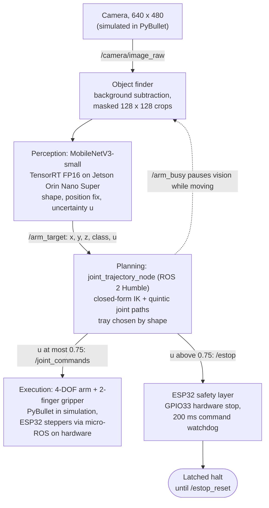

# Automator: Real-Time Uncertainty-Aware Grasping Pipeline for Edge-Accelerated Robotic Arms

A simulated 4-DOF arm sorts objects into bins **by shape**. The perception and control stack runs as ROS 2 nodes
on a Jetson Orin Nano (TensorRT), with an ESP32 (micro-ROS) as the actuator and safety controller.
**Testing on a Jetson? Start with [instructions.md](instructions.md); `scripts/start_dashboard.sh` gives a browser dashboard with live latency tests and video downloads.** Design and rationale: [architecture.md](architecture.md). Known problems and fixes: [docs/PROBLEMS_AND_FIXES.md](docs/PROBLEMS_AND_FIXES.md). Measured results: [report.md](report.md).

## Team
| | |
|---|---|
| Project | Real-Time Uncertainty-Aware Grasping Pipeline for Edge-Accelerated Robotic Arms |
| Team | Team 34 (single member) |
| Member | Siddhant Kumar, 24BCT0062 (all modules) |
| Course | BCSE306 Artificial Intelligence, Slot C1, Fall Semester 2026-27 |
| Faculty | Dr. Ilanthenral Kandasamy |
| Institution | Vellore Institute of Technology, Vellore |
| Track | F (Applied AI: perception and robotics); secondary E |
| Report | [Team34_BCSE306_FinalReview.pdf](docs/Team34_BCSE306_FinalReview.pdf) |
| Demo video | [add link] |

## Architecture

Full design and rationale: [architecture.md](architecture.md).

## Reproduce the main results
**On the Jetson** (after the install in Setup below; use MAXN_SUPER for the numbers in the report: `sudo nvpmodel -m 2 && sudo jetson_clocks`):
```bash
scripts/reproduce_jetson.sh            # add --quick for a short smoke test
```
It runs the self-check, builds the TensorRT FP16 and FP32 engines if missing, benchmarks ONNX Runtime CPU, TensorRT FP32 and TensorRT FP16 (500 iterations each),
measures pure GPU time with `trtexec`, runs a 3-trial x 4-object sorting run with video, writes everything to `docs/jetson_results/run_<timestamp>/` and prints a summary table.
It gives the latency table, the inputs for the sustained-run comparison, and the on-device sorting result (reference values in [docs/JETSON_RESULTS.md](docs/JETSON_RESULTS.md)).

**On a PC** (perception, sorting, unseen-object safety test, unit tests):
```bash
python -m venv .venv && .venv/bin/pip install -r requirements.txt
.venv/bin/python scripts/generate_sim_dataset.py            # render the dataset from the sim camera (about 4 min)
.venv/bin/python scripts/train_perception.py --pretrained   # train, calibrate, evaluate, export ONNX (about 10 min on CPU)
.venv/bin/python scripts/sort_demo.py --trials 20 --video models/sort_demo.mp4
.venv/bin/python scripts/sort_demo.py --trials 30 --objects 4 --unknown 1 --seed 5000 --out models/sort_unknown_results.json
.venv/bin/python -m unittest discover tests                 # 21 tests
```
Add `--gui` to `sort_demo.py` to watch it. Optional: `scripts/train_sac_reach.py` trains the SAC reach controller (1 cm success radius). Measured results: [report.md](report.md).

## Setup
**PC:** Python 3.10 or newer and the packages in `requirements.txt` (first command of the PC block above). The trained model `models/perception.onnx` and `.pt` are committed, so training is optional.

**Jetson (JetPack 6, ROS 2 Humble already installed):**
```bash
git clone https://github.com/RPi-Boy/Automator.git && cd Automator
export AUTOMATOR_ROOT=$PWD
scripts/jetson_install.sh              # apt (TensorRT 10, ffmpeg, OpenCV, micro-ROS agent) + pip (numpy<2, pybullet, onnxruntime, cuda-python)
python3 scripts/jetson_selfcheck.py    # PASS/WARN/FAIL for everything the demo needs
```

## Jetson + ESP32 (ROS 2 Humble)
Measured on a Jetson Orin Nano Super (JetPack 6): the perception to plan path takes **5.91 ms on TensorRT FP16** vs 11.25 ms on the Jetson CPU (500-iteration benchmark, MAXN_SUPER);
a 60 s sustained run held 6.03 ms at 7.0 W average (full numbers in [docs/JETSON_RESULTS.md](docs/JETSON_RESULTS.md)). `scripts/reproduce_jetson.sh` reruns all of it with one command (see above). The trained models `models/perception.onnx` and `.pt` are committed; TensorRT engines are built on the Jetson.
All commands run from the repository root on the Jetson.

**1. Engine** (install and self-check are in Setup above)
```bash
scripts/build_trt_engine.sh fp16       # TensorRT engine, built ON the Jetson -> models/perception_fp16.engine (about 3 min)
```
**2. Browser dashboard (easiest)** - run tests and download results/videos from any browser on the network:
```bash
scripts/start_dashboard.sh             # prints http://<jetson-ip>:8080/?token=...
```
Self-check, latency benchmarks (ONNX CPU vs TensorRT), a live latency chart, `trtexec`, engine builds, sorting runs with video, a ROS/ESP32 snapshot; live frame, log and Jetson telemetry;
every run's files and an H.264 video are downloadable. Stdlib server + token auth + a fixed job list: keep it on a trusted network.

**3. ROS 2 demo (simulated world, perception, planner and a viewer window in one launch)**
```bash
(cd ros2_ws && colcon build --symlink-install --packages-select arm_perception)
scripts/run_jetson_demo.sh                                              # ONNX Runtime
scripts/run_jetson_demo.sh model_path:=$PWD/models/perception_fp16.engine   # TensorRT
scripts/run_jetson_demo.sh inject_unknown:=true seed:=1                 # safety test: an unseen object on the table
```
The viewer shows the simulation, the annotated perception view and live status; keys `e` / `r` send / clear an e-stop. Add `gui:=true` for PyBullet's own window or
`save_video:=run.mp4` to record.

**4. ESP32 over USB** (flash from the Arduino IDE, see `firmware/esp32_microros/README.md`)
```bash
scripts/start_microros_agent.sh        # finds /dev/ttyUSB*, checks permissions, runs the micro-ROS agent
ros2 topic echo /esp32/status          # 5 Hz heartbeat: e-stop latched, motors, fresh command, command count
```
Topics: `/camera/image_raw`, `/camera/reference`, `/sim/spectator`, `/perception/debug`, `/arm_target`, `/arm_busy`, `/joint_commands`, `/estop`, `/estop_reset`, `/esp32/status`.
The vision node pauses while `/arm_busy` is true (the moving arm would otherwise be scored as an unknown object), so an unknown object that enters mid-motion is caught once the arm stops.

**Command-line benchmarks:** `python3 scripts/benchmark_edge.py --model models/perception_fp16.engine --tag jetson_trt_fp16`; pure GPU time with
`/usr/src/tensorrt/bin/trtexec --loadEngine=models/perception_fp16.engine --shapes=crop:3x3x128x128,bbox_feat:3x4`.
A step-by-step guide for people new to the setup, with troubleshooting, is in [instructions.md](instructions.md).

## Layout
```
perception/   detector, camera model, MobileNetV3 + Mahalanobis model, targeting, inference backends (TensorRT via cuda-python / ONNX Runtime / torch)
sim/          sorting scene, simulated arm, URDF, SAC reach env (arm_env.py / trajectory_planner.py are legacy)
scripts/      dataset generation, training, sort demo, SAC training, edge benchmark, TensorRT build, Jetson install/self-check/dashboard/agent/demo launchers
webapp/       edge-test dashboard (server.py, static/index.html)
ros2_ws/      arm_perception: kinematics, trajectory, config, joint_trajectory_node, evidential_vision_node, sim_bridge_node, sim_viewer_node, launch/sort_demo.launch.py
firmware/     ESP32 micro-ROS sketch (Arduino IDE)
tests/        kinematics (vs PyBullet FK), trajectory, perception, integration, overlay
docs/         PROBLEMS_AND_FIXES.md, FULL_PROJECT_REPORT.md, JETSON_RESULTS.md, jetson_results/
```

## Status
- **Verified (PC):** simulation, perception, planning, sorting (74 / 80 = 92.5%), 21 unit/integration tests.
- **Verified (Jetson Orin Nano Super):** ONNX Runtime and TensorRT inference, engine builds, the benchmarks and a 12 / 12 sorting run through the dashboard (`docs/JETSON_RESULTS.md`).
- **Not yet run:** the ROS 2 nodes and launch file under a live ROS 2, the ESP32 sketch (not compiled) and micro-ROS link, hardware e-stop wiring, `steps_per_rad` calibration.
- **Not yet done:** a longer soak test and other Jetson power modes for the TensorRT path.
- **Open:** capsule-like unseen objects are mostly accepted (capsule AUROC 0.71; all unseen objects 0.934); SAC reaches the 1 cm target in only 16% of episodes.
